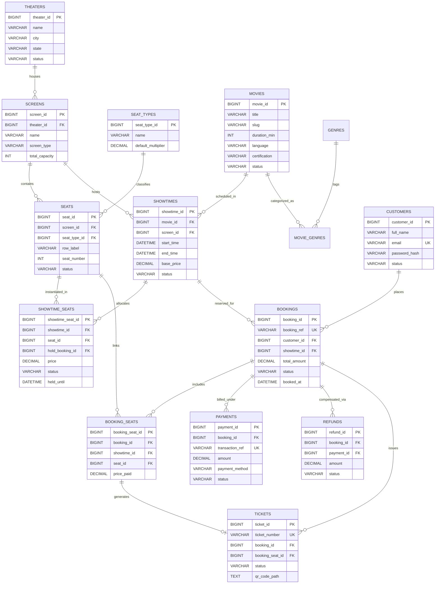
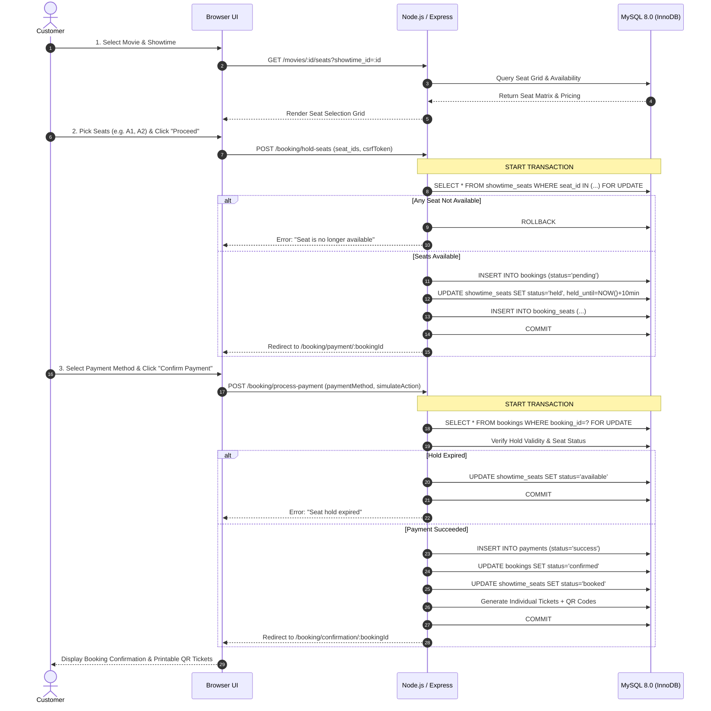

# 🎬 Movie Theater Seat Booking & Showtime Manager

A full-stack, enterprise-grade Cinema Management & Seat Booking System built with **Node.js**, **Express.js**, **EJS**, **Bootstrap 5**, and **MySQL 8.0 (InnoDB)**. Designed with a robust Model-View-Controller (MVC) architecture, strictly parameterized SQL queries, ACID-compliant transaction controls, and pessimistic row locking to prevent double bookings.

---

## 🌟 Key Features

### 👤 Customer Experience
- **Dynamic Movie Catalog**: Browse movies by Now Showing, Upcoming, and Popular status with multi-criteria filtering (genre, language, rating, and search query).
- **Interactive Seat Matrix**: Visual cinema layout featuring Regular, Premium, and Recliner tiers with real-time seat status indicators (Available, Selected, Held, Booked).
- **Temporary Seat Holds**: Automatic 10-minute hold reservation window powered by atomic MySQL row locks (`SELECT ... FOR UPDATE`).
- **Simulated Payment Gateway**: Safe sandbox checkout supporting UPI, Credit/Debit Cards, and Net Banking with immediate simulated success/failure paths.
- **Digital Ticketing & QR Codes**: Instant server-side QR code generation using `qrcode` for each reserved seat with admission verification.
- **Customer Self-Service Portal**: Manage profile, view upcoming/past booking history, download/print tickets, and request cancellations in compliance with refund policies.

### 🛡️ Admin & Cinema Operations
- **Analytical Dashboard**: Real-time KPI cards for box office revenue, bookings, screens, active movies, and occupancy metrics.
- **Visual Analytics**: Interactive revenue and ticket sales trend charts powered by **Chart.js**.
- **Movie Catalog Management**: Full CRUD operations for movies, genres, languages, runtimes, certification ratings, and poster assets.
- **Theater & Screen Management**: Multi-complex management with individual screen capacities, projection formats (2D, 3D, IMAX, 4DX), and sound profiles.
- **Seat Layout Generator**: Batch row/column seat layout generator with category assignment and seat coordinate validation.
- **Showtime Scheduler**: Collision-aware scheduling with automated buffer time validation to prevent screen overlap.
- **Financial & Auditing Reports**: Detailed breakdown of daily receipts, monthly trends, movie-wise grosses, and refund logs.
- **Customer Management**: Customer account search, booking auditing, and account state toggling (active / blocked).

### 🔒 Enterprise Security & Robustness
- **Strict Parameterized Queries**: 100% pure SQL using `mysql2/promise` with parameter markers (`?`) — zero ORM overhead, zero SQL injection surface.
- **Pessimistic Concurrency Control**: High-concurrency seat reservation protected by `SELECT ... FOR UPDATE` row-level locks, ensuring no double-booking race conditions.
- **CSRF Defense**: Synchronizer Token Pattern (`csrf-sync`) enforcing anti-forgery protection across all state-mutating POST requests.
- **Session Security**: Session storage persisted in MySQL (`express-mysql-session`) with `httpOnly`, `sameSite: 'lax'`, and configurable expiration.
- **Rate Limiting & Secure Headers**: DoS and brute-force mitigation via `express-rate-limit` alongside secure HTTP response headers via `helmet`.
- **Password Protection**: Industry-standard password hashing via `bcryptjs` with high cost-factor salting.

---

## 🛠️ Technology Stack

| Layer | Technology | Purpose |
| :--- | :--- | :--- |
| **Runtime** | Node.js (v18+) | Non-blocking asynchronous server runtime |
| **Web Framework** | Express.js 4.x | HTTP routing, middleware pipeline, and REST APIs |
| **Database** | MySQL 8.0 (InnoDB) | Relational database with full foreign keys and transactions |
| **DB Driver** | `mysql2/promise` | Connection pooling and promise-based parameterized queries |
| **Templating Engine**| EJS | Server-side HTML rendering with strict context escaping |
| **Styling & UI** | Tailwind CSS 3 + Bootstrap 5.3 + Custom CSS | Modern cinema dark theme with utility-first responsive styling |
| **Icons & Charts** | Bootstrap Icons & Chart.js | Visual icons and dynamic analytics dashboards |
| **Security** | Helmet, CSRF-Sync, Express-Rate-Limit, BCryptJS | Full OWASP compliance stack |
| **Asset Utilities**| QRCode | SVG/Data-URL QR code generation for digital tickets |

---

## 📁 Project Folder Structure

```
MovieThreaterSeatBookingManager/
├── config/                  # Application & Database Configuration
│   ├── app.js               # Express application initialization & middleware
│   └── db.js                # MySQL connection pool configuration & health check
├── controllers/             # Request Handlers & Presentation Logic
│   ├── adminController.js   # Admin dashboard, catalog & reporting controller
│   ├── authController.js    # Authentication & registration controller
│   ├── bookingController.js # Seat selection, holds, payments & tickets controller
│   ├── customerController.js# Customer account & booking history controller
│   └── movieController.js   # Public browsing & showtimes controller
├── database/                # Database Scripts & Definitions
│   ├── queries.sql          # Operational and analytical SQL queries
│   ├── schema.sql           # Complete DDL for 16 InnoDB tables, constraints & indexes
│   └── seed.sql             # Comprehensive seed data for production-like testing
├── middleware/              # Express Middlewares
│   ├── auth.js              # Session guards for Customer and Admin routes
│   ├── csrf.js              # CSRF protection & view token injection
│   ├── errorHandler.js      # Centralized error & 404 handler
│   ├── rateLimiter.js       # Auth and booking rate limiters
│   └── validation.js        # Input validation rules via express-validator
├── public/                  # Static Assets
│   ├── css/
│   │   ├── admin.css        # Admin dashboard styles
│   │   └── style.css        # Dark theme cinema styling
│   └── js/                  # Client-side validation & seat grid scripts
├── services/                # Core Business Logic & ACID Transactions
│   ├── adminService.js      # Admin aggregation, scheduling & CRUD service
│   ├── authService.js       # User hashing, credential verification & registration
│   ├── bookingService.js    # Pessimistic locking, seat holds & expiration service
│   ├── customerService.js   # Customer profiles & atomic cancellation workflow
│   ├── movieService.js      # Movie search, filter & showtime aggregation service
│   └── paymentService.js    # Simulated payment processing & ticket issuance service
├── tests/                   # Unified Automated Test Suites (66 Tests)
│   ├── test_all.js          # Master runner orchestrating all test suites
│   ├── test_admin.js        # Admin management & screen configuration tests
│   ├── test_auth.js         # Authentication, hashing & session guard tests
│   ├── test_booking.js      # Interactive seat grid & hold reservation tests
│   ├── test_concurrency_audit.js # Race condition & double-booking prevention tests
│   ├── test_customer.js     # Customer dashboard & cancellation workflow tests
│   ├── test_movies.js       # Movie browsing, search & filter tests
│   ├── test_payments.js     # Simulated payment & QR ticket issuance tests
│   ├── test_reports.js      # Dashboard reporting & financial analytics tests
│   └── verify.js            # Server health & smoke check utility
├── views/                   # EJS View Templates
│   ├── admin/               # Admin views (dashboard, movies, screens, reports, etc.)
│   ├── customer/            # Customer views (dashboard, tickets, profile, etc.)
│   ├── movies/              # Movie listing, movie details, showtime selector
│   ├── partials/            # Reusable components (navbar, footer, flash alerts)
│   └── index.ejs            # Homepage view
├── .env.example             # Template for environment configuration
├── package.json             # Project dependencies & npm scripts
└── server.js                # Application entrypoint & background hold cleanup worker
```

---

## 🗄️ Database Setup (XAMPP / MySQL 8.0)

### 1. Prerequisites
- Install **XAMPP** (or standalone **MySQL Server 8.0+**).
- Start the MySQL service from the XAMPP Control Panel.

### 2. Create and Seed Database via CLI
Open your terminal or PowerShell and run:

```bash
# Log in to MySQL console
mysql -u root -p

# Create the database
CREATE DATABASE movie_theater_db CHARACTER SET utf8mb4 COLLATE utf8mb4_unicode_ci;
EXIT;

# Import the schema (creates all 16 tables, constraints, and indexes)
mysql -u root -p movie_theater_db < database/schema.sql

# Import initial seed data (theaters, screens, seats, movies, showtimes, admins)
mysql -u root -p movie_theater_db < database/seed.sql
```

### 3. Alternative: Setup via phpMyAdmin
1. Navigate to `http://localhost/phpmyadmin/` in your browser.
2. Click **New** on the left navigation bar and create a database named `movie_theater_db` with collation `utf8mb4_unicode_ci`.
3. Select `movie_theater_db` and click the **Import** tab.
4. Choose [`database/schema.sql`](file:///e:/projects/MovieThreaterSeatBookingManager/database/schema.sql) and click **Go**.
5. Once imported, click the **Import** tab again, select [`database/seed.sql`](file:///e:/projects/MovieThreaterSeatBookingManager/database/seed.sql), and click **Go**.

---

## ⚙️ Environment Configuration

Create a `.env` file in the project root directory by copying `.env.example`:

```bash
cp .env.example .env
```

Configure your environment settings in `.env`:

```env
# Server Configuration
PORT=3000
NODE_ENV=development

# MySQL Database Connection
DB_HOST=127.0.0.1
DB_PORT=3306
DB_USER=root
DB_PASSWORD=your_mysql_password
DB_NAME=movie_theater_db

# Session Security Configuration
SESSION_SECRET=super_secure_random_cinema_session_key_982348234
SESSION_LIFETIME_MINUTES=120
```

---

## 🚀 Installation & Running

```bash
# 1. Install dependencies
npm install

# 2. Run database connection test
npm run test:db

# 3. Start the application
npm start

# Or start in development mode with nodemon
npm run dev
```

The application will be live at: **`http://localhost:3000`**

---

## 🧪 Comprehensive Testing Suite

The application includes an extensive suite of **66 automated tests across 9 test modules** covering unit operations, end-to-end flows, and high-concurrency race condition scenarios.

Execute the master verification suite with a single command:

```bash
npm test
```

### Individual Test Suites
```bash
npm run test:auth         # Authentication & session verification
npm run test:movies       # Public browsing, search & filter verification
npm run test:admin        # Admin catalog CRUD & screen configuration
npm run test:booking      # Seat matrix, hold reservations & hold cancellations
npm run test:payments     # Payment simulation, ticket generation & QR validation
npm run test:reports      # Admin metrics, financial reports & aggregations
npm run test:customer     # Customer portal, cancellations & profile updates
npm run test:concurrency  # Concurrency, double-booking prevention & ACID race conditions
```

---

## 🔑 Default Seeded Credentials

### 🛡️ Administrator Account
- **URL**: `http://localhost:3000/auth/admin/login`
- **Email**: `admin@cinema.com`
- **Password**: `Admin@123`

### 👤 Sample Customer Accounts
- **URL**: `http://localhost:3000/auth/login`
- **Customer 1**:
  - **Email**: `john.doe@example.com`
  - **Password**: `Password@123`
- **Customer 2**:
  - **Email**: `jane.smith@example.com`
  - **Password**: `Password@123`

*(You may also register a new customer account at `http://localhost:3000/auth/register`)*

---

## 📊 Database Entity-Relationship (ER) Diagram



---

## 💡 Important SQL Queries

### 1. Pessimistic Row-Locking for Concurrency Control
Prevents race conditions when two customers attempt to select the same seats simultaneously:

```sql
-- Lock target seat records for update inside an active ACID transaction
SELECT ss.showtime_seat_id, ss.seat_id, ss.status, ss.price, ss.held_until
FROM showtime_seats ss
WHERE ss.showtime_id = ? AND ss.seat_id IN (?)
FOR UPDATE;
```

### 2. Automated Expired Hold Reclaim
Recovers seats held by abandoned booking sessions (older than 10 minutes):

```sql
UPDATE showtime_seats
SET status = 'available',
    held_until = NULL,
    hold_booking_id = NULL
WHERE status = 'held' AND held_until < NOW();
```

### 3. Movie-Wise Box Office Revenue Aggregation
Admin reporting aggregate calculating confirmed tickets sold and gross box office intake:

```sql
SELECT 
    m.movie_id,
    m.title,
    m.language,
    m.certification,
    COUNT(DISTINCT b.booking_id) AS total_confirmed_bookings,
    COUNT(DISTINCT bs.booking_seat_id) AS total_tickets_sold,
    COALESCE(SUM(bs.price_paid), 0.00) AS total_box_office_gross
FROM movies m
LEFT JOIN showtimes s ON m.movie_id = s.movie_id
LEFT JOIN bookings b ON s.showtime_id = b.showtime_id AND b.status = 'confirmed'
LEFT JOIN booking_seats bs ON b.booking_id = bs.booking_id
GROUP BY m.movie_id, m.title, m.language, m.certification
ORDER BY total_tickets_sold DESC;
```

---

## 🎟️ Complete Booking Workflow



---

## 🖥️ User Interface & Visual Walkthrough

- **Home Page (`/`)**: Hero carousel presenting top featured films, "Now Showing" slider cards, and "Upcoming Releases".
- **Movie Details (`/movies/:id`)**: Comprehensive synopsis, trailer links, genre tags, duration, and theater/showtime picker tabs.
- **Interactive Seat Map (`/movies/:id/seats`)**: Curved cinema screen graphic with categorized seat sections (Regular, Premium, Recliner) and live price tally.
- **Checkout & Payment Simulation (`/booking/payment/:bookingId`)**: Clean countdown timer showing hold expiration, breakdown of ticket costs, payment method selector, and simulate buttons.
- **Digital Ticket Page (`/customer/tickets/:ticketNumber`)**: Clean boarding-pass style ticket view containing ticket ID, seat number, auditorium details, and scannable QR code.
- **Admin Analytics Dashboard (`/admin/dashboard`)**: KPI dashboard with responsive charts, recent transaction tables, and administrative controls.

---

## 📜 License & Academic Integrity

This project was developed for demonstration, educational, and academic database management course requirements. Feel free to use and adapt this system for educational purposes.
