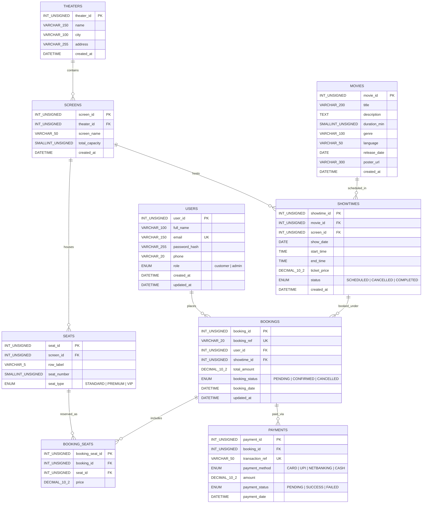

# 🎬 CineSeat - Movie Theater Seat Booking & Showtime Manager
> **Academic DBMS Laboratory Project (3rd Semester B.Tech Computer Science & Engineering)**  
> Built with **Node.js**, **Express.js**, **EJS**, **Bootstrap 5**, and **MySQL 8.0 (InnoDB Engine)**.

---

## 📌 Project Overview

**CineSeat** is a full-stack cinema theater seat booking and showtime management web application developed specifically for a 3rd-semester Database Management Systems (DBMS) laboratory project. 

The architecture focuses strictly on core relational database concepts:
1. **Relational Schema Design**: 9 normalized InnoDB tables in Third Normal Form (3NF).
2. **Referential Integrity**: Comprehensive primary keys, unique keys, foreign keys with `ON DELETE CASCADE` and `ON DELETE RESTRICT` constraints.
3. **Pure Parameterized SQL**: Built with `mysql2/promise` using parameterized queries (`?`) to guarantee zero SQL injection vulnerabilities.
4. **ACID Transaction Semantics**: Multi-step booking and payment execution with atomic `START TRANSACTION`, `COMMIT`, and `ROLLBACK`.
5. **Pessimistic Concurrency Control**: High-concurrency seat reservation protected by `SELECT ... FOR UPDATE` row locks to prevent double-booking race conditions.
6. **Clean, Minimal UI**: Built with standard Bootstrap 5 without bloated third-party CSS frameworks.

---

## 🗄️ Database Architecture (9 Core Tables)

The database `movie_theater_db` (MySQL 8.0+ / InnoDB / `utf8mb4_unicode_ci`) consists of 9 core normalized tables in Third Normal Form (3NF):



### Key Constraints & Referential Integrity

| Table | Unique Keys | Foreign Keys (`ON DELETE` / `ON UPDATE`) | Check Constraints |
| :--- | :--- | :--- | :--- |
| **`users`** | `email` | — | — |
| **`theaters`** | `(name, city)` | — | — |
| **`screens`** | `(theater_id, screen_name)` | `theater_id` → `theaters` (`CASCADE` / `CASCADE`) | `total_capacity > 0` |
| **`seats`** | `(screen_id, row_label, seat_number)` | `screen_id` → `screens` (`CASCADE` / `CASCADE`) | `seat_number > 0` |
| **`movies`** | — | — | `duration_min > 0` |
| **`showtimes`** | — | `movie_id` → `movies` (`RESTRICT` / `CASCADE`)<br>`screen_id` → `screens` (`RESTRICT` / `CASCADE`) | `end_time > start_time`<br>`ticket_price >= 0.00` |
| **`bookings`** | `booking_ref` | `user_id` → `users` (`RESTRICT` / `CASCADE`)<br>`showtime_id` → `showtimes` (`RESTRICT` / `CASCADE`) | `total_amount >= 0.00` |
| **`booking_seats`** | `(booking_id, seat_id)` | `booking_id` → `bookings` (`CASCADE` / `CASCADE`)<br>`seat_id` → `seats` (`RESTRICT` / `CASCADE`) | `price >= 0.00` |
| **`payments`** | `transaction_ref` | `booking_id` → `bookings` (`RESTRICT` / `CASCADE`) | `amount > 0.00` |

> **Auxiliary Objects**: Running the application also creates a `sessions` table via `express-mysql-session`, and `advanced_queries.sql` adds the `booking_status_audit` table (populated by `trg_after_booking_status_update`) along with reporting views (`vw_customer_booking_details`, `vw_movie_showtime_details`, `vw_revenue_summary`).

---

## 🌟 Key Application Features

### 👤 Customer Experience
- **Movie Catalog**: Browse now-showing and upcoming movies with genre, language, and search filtering.
- **Auditorium Screenings**: View showtimes organized by date, theater venue, and auditorium screen.
- **Interactive Seat Matrix**: Real-time cinema seat selection showing standard, premium, and VIP tiers.
- **Seat Hold & ACID Booking**: Atomic reservation holding seats during the checkout window.
- **Simulated Payment Gateway**: Safe sandbox checkout supporting UPI, Cards, and Net Banking.
- **Digital Ticketing & QR Pass**: Printable admission pass with scannable QR verification code.
- **Customer Self-Service**: Lifetime booking history, upcoming show tracking, and instant cancellation.

### 🛡️ Admin Management & Audit Portal
- **DBMS Operations Dashboard**: Real-time aggregate statistics for revenue, bookings, screens, and active films.
- **Movie Catalog CRUD**: Add, edit, or delete movies, poster URLs, languages, runtimes, and genres.
- **Theaters & Screen Configuration**: Manage theater complexes and auditorium seating capacities.
- **Seat Matrix Generator**: Add single seats or batch-generate entire seating rows.
- **Showtime Scheduling**: Schedule movie screenings with conflict checks.
- **Transaction & Payment Auditing**: Full audit log of bookings, customer details, and settled payments.

---

## 🛠️ Technology Stack

| Layer | Technology | Purpose |
| :--- | :--- | :--- |
| **Runtime** | Node.js (v18+) | Asynchronous event-driven server runtime |
| **Web Framework** | Express.js 4.x | HTTP routing, session management, and middleware |
| **Database** | MySQL 8.0+ / 9.x | Relational database with InnoDB engine and ACID transactions |
| **DB Driver** | `mysql2/promise` | Connection pooling and promise-based parameterized queries |
| **Templating** | EJS | Server-side HTML rendering with clean partial modularity |
| **Styling** | Bootstrap 5.3 + Bootstrap Icons | Clean, responsive cinema dark UI |
| **Security** | Helmet, CSRF-Sync, Express-Rate-Limit, BCryptJS | Session security, CSRF protection, and password hashing |
| **QR Code** | `qrcode` | Instant server-side QR code generation for tickets |

---

## 🚀 Setup & Installation (XAMPP / MySQL)

### 1. Prerequisites
- **Node.js** (v18 or higher)
- **MySQL 8.0+** (or **XAMPP** with MySQL module running on port 3306)

### 2. Database Initialization
Open terminal / command prompt and import the database:

```bash
# Log in to MySQL console
mysql -u root -p

# Create the database
CREATE DATABASE movie_theater_db CHARACTER SET utf8mb4 COLLATE utf8mb4_unicode_ci;
EXIT;

# Import the schema (creates all 9 tables, constraints, and indexes)
mysql -u root -p movie_theater_db < database/schema.sql

# Import seed data (10 Indian movies with posters, theaters, screens, seats, users)
mysql -u root -p movie_theater_db < database/seed.sql

# (Optional: or run the all-in-one script)
mysql -u root -p movie_theater_db < database.sql
```

### 3. Environment Configuration
Create a `.env` file in the root directory (or edit the existing `.env`):

```env
PORT=3000
NODE_ENV=development

# MySQL Database Connection
DB_HOST=127.0.0.1
DB_PORT=3306
DB_USER=root
DB_PASSWORD=your_mysql_password
DB_NAME=movie_theater_db

# Session Security
SESSION_SECRET=super_secure_random_cinema_session_key_982348234
SESSION_LIFETIME_MINUTES=120
```

### 4. Install Dependencies & Start Server
```bash
# Install dependencies
npm install

# Run database connection check
npm run test:db

# Run automated verification suite
npm test

# Start the application server
npm start
```

Visit the application at: **`http://localhost:3000`**

---

## 🔑 Default Accounts (Seed Data)

### 🛡️ System Administrator
- **Email**: `admin@cinemanager.com`
- **Password**: `admin123`
- **Role**: Admin (Full access to `/admin/dashboard`, CRUD management, and audit tables)

### 👤 Sample Customer Accounts
- **Customer 1**:
  - **Email**: `aarav.sharma@example.com`
  - **Password**: `password123`
- **Customer 2**:
  - **Email**: `priya.patel@example.com`
  - **Password**: `password123`

*(New customer accounts can also be created via `http://localhost:3000/register`)*

---

## 🧪 Automated Verification Suite

Run the built-in verification suite anytime:

```bash
npm test
```

Verifies:
- Live MySQL connection and health check (`/health`)
- All 9 normalized relational tables exist
- Foreign key and referential constraint integrity
- Public and protected route authentication guards

---

## 📂 Project Directory Structure

```
MovieThreaterSeatBookingManager/
├── config/                  # Database pool & session configuration
│   ├── db.js                # MySQL2 promise connection pool & health check
│   └── session.js           # Session store configuration
├── controllers/             # Business logic & database operations
│   ├── adminController.js   # Admin operations & table CRUD
│   ├── authController.js    # Login, registration & session auth
│   ├── bookingController.js # Seat selection, holds, cancellations & customer portal
│   ├── movieController.js   # Movie catalog & showtimes
│   └── paymentController.js # Payment processing & ticket issuance
├── database/                # Database scripts & documentation
│   ├── DBMS_DESIGN_REPORT.md# Complete 3rd-semester DBMS laboratory report
│   ├── queries.sql          # Demonstration SQL queries for lab viva/exam
│   ├── schema.sql           # DDL schema for 9 normalized tables
│   └── seed.sql             # Seed data with 10 Indian movies & online posters
├── database.sql             # Unified schema + seed script
├── advanced_queries.sql     # Joins, subqueries, views, procedures & triggers
├── middlewares/             # Express middleware pipeline
│   ├── auth.js              # Customer & Admin authentication guards
│   ├── csrf.js              # CSRF token protection
│   ├── errorHandler.js      # Centralized error handler & 404 page
│   ├── rateLimiter.js       # Rate limiter
│   └── validators.js        # Input validation rules
├── public/                  # Static frontend assets
│   ├── css/style.css        # Clean cinema dark theme & anti-shake layout rules
│   ├── images/posters/      # Fallback images & local posters
│   └── js/                  # Client-side seat selection scripts
├── routes/                  # Express route definitions
│   ├── adminRoutes.js       # /admin/* protected routes
│   ├── authRoutes.js        # /login, /register, /logout
│   ├── bookingRoutes.js     # /customer/bookings, /bookings/*
│   ├── movieRoutes.js       # /movies, /movies/showtimes, /theaters
│   ├── paymentRoutes.js     # /bookings/:id/payment, /bookings/:id/pay
│   └── index.js             # Root router aggregator
├── tests/                   # Automated verification suite
│   └── verify.js            # Database schema & HTTP route verification
├── views/                   # EJS UI templates
│   ├── admin/               # Admin views (dashboard, movies, screens, seats, showtimes, audits)
│   ├── auth/                # Login & Registration views
│   ├── bookings/            # Seat selection, payment & ticket print views
│   ├── customer/            # Customer portal dashboard & bookings
│   ├── pages/               # Homepage, movies catalog, showtimes, theaters, 404
│   └── partials/            # Header, navbar, footer, alerts, admin sidebar
├── app.js                   # Express application setup
├── package.json             # NPM dependencies & scripts
└── server.js                # Server entrypoint
```

---

## 📜 Academic DBMS Viva / Exam Reference

For laboratory examinations and viva voce, demonstration SQL scripts covering all essential relational concepts are prepared:
- [`database/queries.sql`](./database/queries.sql): Core queries demonstrating multi-table `JOIN`, `GROUP BY`, `HAVING`, `COUNT`, `SUM`, and subqueries.
- [`advanced_queries.sql`](./advanced_queries.sql): Demonstrates Views, B-Tree Indexes, Stored Procedures, Triggers, and ACID transactions.
- [`database/DBMS_DESIGN_REPORT.md`](./database/DBMS_DESIGN_REPORT.md): Full laboratory report with relational schema, 3NF normalization, and data dictionary.
