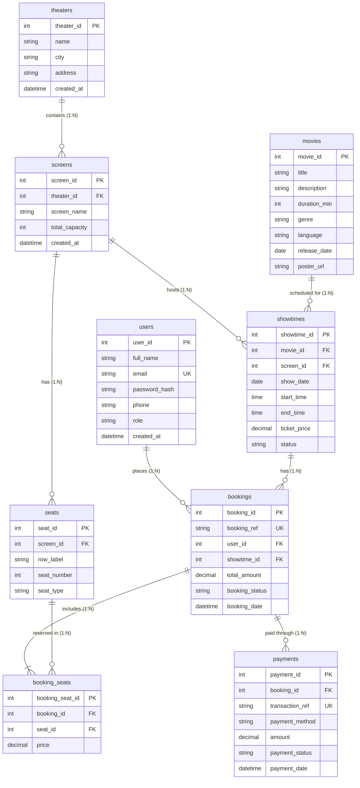

# DBMS Laboratory Project Design Document
## Movie Theater Seat Booking & Showtime Manager

**Academic Level:** 2nd-Year B.Tech Computer Science & Engineering / Information Technology  
**Subject:** Database Management Systems (DBMS) Laboratory  
**Project Title:** Movie Theater Seat Booking & Showtime Manager  
**Database Engine:** MySQL 8.0 (InnoDB Engine, utf8mb4 charset, strict SQL mode)  
**Backend Stack:** Node.js, Express.js (Direct SQL queries using `mysql2/promise`, NO ORM)  
**Frontend Stack:** EJS Templates, HTML5, CSS3, Vanilla JavaScript  
**Environment:** XAMPP MySQL / phpMyAdmin / MySQL Workbench  

---

## 1. Project Directory Inspection Findings

During the initial inspection of the existing workspace `MovieThreaterSeatBookingManager`, the following state was observed:
1. **Current Codebase Complexity:** The workspace currently contains an enterprise-style architecture with 16 tables (`customers`, `admins`, `theaters`, `screens`, `seat_types`, `seats`, `movies`, `genres`, `movie_genres`, `showtimes`, `showtime_seats`, `bookings`, `booking_seats`, `payments`, `refunds`, `tickets`).
2. **Pedagogical Gap:** For a 2nd-year B.Tech DBMS lab evaluation, a 16-table schema introduces unnecessary bloat (e.g., dual login tables for admin vs. customer, separate genre junction tables, duplicate ticket rendering tables, and redundant pre-allocated `showtime_seats` inventory tables).
3. **Target Scope:** We will streamline and consolidate the architecture into **exactly 9 core relational tables**:
   - `users` (unified table with role-based distinction: `customer` vs. `admin`)
   - `movies`
   - `theaters`
   - `screens`
   - `seats`
   - `showtimes`
   - `bookings`
   - `booking_seats`
   - `payments`

---

## 2. Proposed Project Folder Structure

The project follows a clean Model-View-Controller (MVC) pattern without ORM overhead. Direct, parameterized SQL queries are executed using `mysql2/promise` connection pooling to safeguard against SQL injection.

```text
MovieThreaterSeatBookingManager/
├── config/
│   └── db.js                 # MySQL 8 connection pool setup using mysql2/promise
├── controllers/
│   ├── authController.js     # User registration, login, logout, password hashing
│   ├── movieController.js    # Public catalog & movie details with showtimes
│   ├── bookingController.js  # Seat selection, active booking transaction, status handling
│   ├── paymentController.js  # Payment simulation, status update, transaction commit
│   └── adminController.js    # Admin CRUD for movies, theaters, screens, showtimes, reports
├── database/
│   ├── schema.sql            # Core 9-table DDL script (tables, keys, constraints, indexes)
│   ├── seed.sql              # Clean sample data for testing and lab demonstration
│   ├── queries.sql           # Important lab demonstration queries (JOINs, aggregations)
│   └── DBMS_DESIGN_REPORT.md # This complete architectural and design report
├── middleware/
│   ├── auth.js               # Session verification & role check (isAuthenticated, isAdmin)
│   └── errorHandler.js       # Centralized HTTP & SQL error handling
├── public/
│   ├── css/
│   │   └── style.css         # Modern, clean student-friendly stylesheet
│   └── js/
│       ├── main.js           # Interactive UI scripts (modal, toast dismissals)
│       └── seatSelection.js  # Visual seat grid selection & price calculator
├── routes/
│   ├── index.js              # Central route aggregator
│   ├── authRoutes.js         # /login, /register, /logout
│   ├── movieRoutes.js        # /movies, /movies/:id
│   ├── bookingRoutes.js      # /book/:showtimeId, /bookings/my-bookings, /cancel/:id
│   ├── paymentRoutes.js      # /payment/:bookingId, /payment/process
│   └── adminRoutes.js        # /admin (dashboard, movies, screens, showtimes, reports)
├── views/
│   ├── partials/
│   │   ├── header.ejs        # Head tag, navigation bar
│   │   ├── footer.ejs        # Footer and script inclusions
│   │   └── alerts.ejs        # Flash message notifications
│   ├── auth/
│   │   ├── login.ejs         # Login form for both customer and admin
│   │   └── register.ejs      # Customer registration form
│   ├── pages/
│   │   ├── home.ejs          # Home landing page with currently showing movies
│   │   ├── movie-details.ejs # Movie info & available showtimes by theater
│   │   └── 404.ejs           # Not found page
│   ├── bookings/
│   │   ├── select-seats.ejs  # Interactive seat grid for a selected showtime
│   │   ├── payment.ejs       # Payment checkout & method selection
│   │   ├── confirmation.ejs  # Booking confirmation & printable summary
│   │   └── my-bookings.ejs   # Customer booking history & cancellation option
│   └── admin/
│       ├── dashboard.ejs     # Admin statistics & quick metrics
│       ├── movies.ejs        # Manage movies (Add, Edit, Delete)
│       ├── theaters.ejs      # Manage theaters & screens
│       ├── showtimes.ejs     # Manage scheduled showtimes
│       └── bookings.ejs      # View all theater reservations & payment audit
├── .env                      # DB connection variables & session secret
├── .env.example              # Sample environment configuration template
├── package.json              # Project metadata & npm dependencies
└── server.js                 # Express server bootstrap & port listener
```

---

## 3. Database Schema Specification (9 Core Tables)

### Summary Table

| # | Table Name | Primary Key | Foreign Keys | Key Purpose |
|---|------------|-------------|--------------|-------------|
| 1 | `users` | `user_id` | *None* | Authentication & profile for both customers and administrators. |
| 2 | `theaters` | `theater_id` | *None* | Physical cinema venues. |
| 3 | `screens` | `screen_id` | `theater_id` -> `theaters(theater_id)` | Individual auditoriums/halls inside a theater. |
| 4 | `seats` | `seat_id` | `screen_id` -> `screens(screen_id)` | Physical seating inventory belonging to a screen. |
| 5 | `movies` | `movie_id` | *None* | Catalog of films available for exhibition. |
| 6 | `showtimes` | `showtime_id` | `movie_id` -> `movies(movie_id)`<br>`screen_id` -> `screens(screen_id)` | Scheduled screenings of a movie on a screen at a date/time. |
| 7 | `bookings` | `booking_id` | `user_id` -> `users(user_id)`<br>`showtime_id` -> `showtimes(showtime_id)` | Reservation master record placed by customers. |
| 8 | `booking_seats` | `booking_seat_id` | `booking_id` -> `bookings(booking_id)`<br>`seat_id` -> `seats(seat_id)` | Junction entity recording individual seats booked in a reservation. |
| 9 | `payments` | `payment_id` | `booking_id` -> `bookings(booking_id)` | Financial transaction attempts associated with a booking. |

---

### Detailed DDL Specifications

```sql
-- =====================================================================
-- DATABASE CREATION
-- =====================================================================
CREATE DATABASE IF NOT EXISTS `movie_theater_db`
    CHARACTER SET utf8mb4
    COLLATE utf8mb4_unicode_ci;

USE `movie_theater_db`;

SET FOREIGN_KEY_CHECKS = 0;

-- ---------------------------------------------------------------------
-- 1. Table: users
-- Unified table for customers and admins (simplifies auth in 2nd-year scope)
-- ---------------------------------------------------------------------
DROP TABLE IF EXISTS `users`;
CREATE TABLE `users` (
    `user_id`       INT UNSIGNED AUTO_INCREMENT PRIMARY KEY,
    `full_name`     VARCHAR(100) NOT NULL,
    `email`         VARCHAR(150) NOT NULL,
    `password_hash` VARCHAR(255) NOT NULL,
    `phone`         VARCHAR(20)  NULL,
    `role`          ENUM('customer', 'admin') NOT NULL DEFAULT 'customer',
    `created_at`    DATETIME NOT NULL DEFAULT CURRENT_TIMESTAMP,
    `updated_at`    DATETIME NOT NULL DEFAULT CURRENT_TIMESTAMP ON UPDATE CURRENT_TIMESTAMP,
    CONSTRAINT `uq_users_email` UNIQUE (`email`),
    INDEX `idx_users_role` (`role`)
) ENGINE=InnoDB DEFAULT CHARSET=utf8mb4 COLLATE=utf8mb4_unicode_ci;

-- ---------------------------------------------------------------------
-- 2. Table: theaters
-- Physical theater locations
-- ---------------------------------------------------------------------
DROP TABLE IF EXISTS `theaters`;
CREATE TABLE `theaters` (
    `theater_id` INT UNSIGNED AUTO_INCREMENT PRIMARY KEY,
    `name`       VARCHAR(150) NOT NULL,
    `city`       VARCHAR(100) NOT NULL,
    `address`    VARCHAR(255) NOT NULL,
    `created_at` DATETIME NOT NULL DEFAULT CURRENT_TIMESTAMP,
    CONSTRAINT `uq_theaters_name_city` UNIQUE (`name`, `city`),
    INDEX `idx_theaters_city` (`city`)
) ENGINE=InnoDB DEFAULT CHARSET=utf8mb4 COLLATE=utf8mb4_unicode_ci;

-- ---------------------------------------------------------------------
-- 3. Table: screens
-- Multiple screens per theater
-- ---------------------------------------------------------------------
DROP TABLE IF EXISTS `screens`;
CREATE TABLE `screens` (
    `screen_id`      INT UNSIGNED AUTO_INCREMENT PRIMARY KEY,
    `theater_id`     INT UNSIGNED NOT NULL,
    `screen_name`    VARCHAR(50)  NOT NULL,
    `total_capacity` SMALLINT UNSIGNED NOT NULL,
    `created_at`     DATETIME NOT NULL DEFAULT CURRENT_TIMESTAMP,
    CONSTRAINT `fk_screens_theaters` 
        FOREIGN KEY (`theater_id`) REFERENCES `theaters` (`theater_id`) 
        ON DELETE CASCADE ON UPDATE CASCADE,
    CONSTRAINT `uq_screens_theater_name` UNIQUE (`theater_id`, `screen_name`),
    CONSTRAINT `chk_screen_capacity` CHECK (`total_capacity` > 0),
    INDEX `idx_screens_theater` (`theater_id`)
) ENGINE=InnoDB DEFAULT CHARSET=utf8mb4 COLLATE=utf8mb4_unicode_ci;

-- ---------------------------------------------------------------------
-- 4. Table: seats
-- Physical seats mapped to a screen
-- ---------------------------------------------------------------------
DROP TABLE IF EXISTS `seats`;
CREATE TABLE `seats` (
    `seat_id`     INT UNSIGNED AUTO_INCREMENT PRIMARY KEY,
    `screen_id`   INT UNSIGNED NOT NULL,
    `row_label`   VARCHAR(5)   NOT NULL,
    `seat_number` SMALLINT UNSIGNED NOT NULL,
    `seat_type`   ENUM('STANDARD', 'PREMIUM', 'VIP') NOT NULL DEFAULT 'STANDARD',
    CONSTRAINT `fk_seats_screens` 
        FOREIGN KEY (`screen_id`) REFERENCES `screens` (`screen_id`) 
        ON DELETE CASCADE ON UPDATE CASCADE,
    CONSTRAINT `uq_seats_position` UNIQUE (`screen_id`, `row_label`, `seat_number`),
    CONSTRAINT `chk_seat_number` CHECK (`seat_number` > 0),
    INDEX `idx_seats_screen` (`screen_id`)
) ENGINE=InnoDB DEFAULT CHARSET=utf8mb4 COLLATE=utf8mb4_unicode_ci;

-- ---------------------------------------------------------------------
-- 5. Table: movies
-- Movie catalog
-- ---------------------------------------------------------------------
DROP TABLE IF EXISTS `movies`;
CREATE TABLE `movies` (
    `movie_id`     INT UNSIGNED AUTO_INCREMENT PRIMARY KEY,
    `title`        VARCHAR(200) NOT NULL,
    `description`  TEXT         NULL,
    `duration_min` SMALLINT UNSIGNED NOT NULL,
    `genre`        VARCHAR(100) NOT NULL,
    `language`     VARCHAR(50)  NOT NULL,
    `release_date` DATE         NOT NULL,
    `poster_url`   VARCHAR(300) NULL,
    `created_at`   DATETIME NOT NULL DEFAULT CURRENT_TIMESTAMP,
    CONSTRAINT `chk_movie_duration` CHECK (`duration_min` > 0),
    INDEX `idx_movies_title` (`title`),
    INDEX `idx_movies_release_date` (`release_date`)
) ENGINE=InnoDB DEFAULT CHARSET=utf8mb4 COLLATE=utf8mb4_unicode_ci;

-- ---------------------------------------------------------------------
-- 6. Table: showtimes
-- Screening schedule linking movie, screen, and time
-- ---------------------------------------------------------------------
DROP TABLE IF EXISTS `showtimes`;
CREATE TABLE `showtimes` (
    `showtime_id`  INT UNSIGNED AUTO_INCREMENT PRIMARY KEY,
    `movie_id`     INT UNSIGNED NOT NULL,
    `screen_id`    INT UNSIGNED NOT NULL,
    `show_date`    DATE         NOT NULL,
    `start_time`   TIME         NOT NULL,
    `end_time`     TIME         NOT NULL,
    `ticket_price` DECIMAL(10,2) NOT NULL,
    `status`       ENUM('SCHEDULED', 'CANCELLED', 'COMPLETED') NOT NULL DEFAULT 'SCHEDULED',
    `created_at`   DATETIME NOT NULL DEFAULT CURRENT_TIMESTAMP,
    CONSTRAINT `fk_showtimes_movies` 
        FOREIGN KEY (`movie_id`) REFERENCES `movies` (`movie_id`) 
        ON DELETE RESTRICT ON UPDATE CASCADE,
    CONSTRAINT `fk_showtimes_screens` 
        FOREIGN KEY (`screen_id`) REFERENCES `screens` (`screen_id`) 
        ON DELETE RESTRICT ON UPDATE CASCADE,
    CONSTRAINT `chk_showtime_duration` CHECK (`end_time` > `start_time`),
    CONSTRAINT `chk_ticket_price` CHECK (`ticket_price` >= 0.00),
    INDEX `idx_showtimes_movie` (`movie_id`),
    INDEX `idx_showtimes_screen` (`screen_id`),
    INDEX `idx_showtimes_schedule` (`show_date`, `start_time`)
) ENGINE=InnoDB DEFAULT CHARSET=utf8mb4 COLLATE=utf8mb4_unicode_ci;

-- ---------------------------------------------------------------------
-- 7. Table: bookings
-- Reservation master record made by customer
-- ---------------------------------------------------------------------
DROP TABLE IF EXISTS `bookings`;
CREATE TABLE `bookings` (
    `booking_id`     INT UNSIGNED AUTO_INCREMENT PRIMARY KEY,
    `booking_ref`    VARCHAR(20)  NOT NULL,
    `user_id`        INT UNSIGNED NOT NULL,
    `showtime_id`    INT UNSIGNED NOT NULL,
    `total_amount`   DECIMAL(10,2) NOT NULL DEFAULT 0.00,
    `booking_status` ENUM('PENDING', 'CONFIRMED', 'CANCELLED') NOT NULL DEFAULT 'PENDING',
    `booking_date`   DATETIME NOT NULL DEFAULT CURRENT_TIMESTAMP,
    `updated_at`     DATETIME NOT NULL DEFAULT CURRENT_TIMESTAMP ON UPDATE CURRENT_TIMESTAMP,
    CONSTRAINT `uq_bookings_ref` UNIQUE (`booking_ref`),
    CONSTRAINT `fk_bookings_users` 
        FOREIGN KEY (`user_id`) REFERENCES `users` (`user_id`) 
        ON DELETE RESTRICT ON UPDATE CASCADE,
    CONSTRAINT `fk_bookings_showtimes` 
        FOREIGN KEY (`showtime_id`) REFERENCES `showtimes` (`showtime_id`) 
        ON DELETE RESTRICT ON UPDATE CASCADE,
    CONSTRAINT `chk_booking_total` CHECK (`total_amount` >= 0.00),
    INDEX `idx_bookings_user` (`user_id`),
    INDEX `idx_bookings_showtime` (`showtime_id`),
    INDEX `idx_bookings_status` (`booking_status`)
) ENGINE=InnoDB DEFAULT CHARSET=utf8mb4 COLLATE=utf8mb4_unicode_ci;

-- ---------------------------------------------------------------------
-- 8. Table: booking_seats
-- Individual seats reserved within a booking
-- ---------------------------------------------------------------------
DROP TABLE IF EXISTS `booking_seats`;
CREATE TABLE `booking_seats` (
    `booking_seat_id` INT UNSIGNED AUTO_INCREMENT PRIMARY KEY,
    `booking_id`      INT UNSIGNED NOT NULL,
    `seat_id`         INT UNSIGNED NOT NULL,
    `price`           DECIMAL(10,2) NOT NULL,
    CONSTRAINT `fk_bs_bookings` 
        FOREIGN KEY (`booking_id`) REFERENCES `bookings` (`booking_id`) 
        ON DELETE CASCADE ON UPDATE CASCADE,
    CONSTRAINT `fk_bs_seats` 
        FOREIGN KEY (`seat_id`) REFERENCES `seats` (`seat_id`) 
        ON DELETE RESTRICT ON UPDATE CASCADE,
    CONSTRAINT `uq_bs_booking_seat` UNIQUE (`booking_id`, `seat_id`),
    CONSTRAINT `chk_bs_price` CHECK (`price` >= 0.00),
    INDEX `idx_bs_booking` (`booking_id`),
    INDEX `idx_bs_seat` (`seat_id`)
) ENGINE=InnoDB DEFAULT CHARSET=utf8mb4 COLLATE=utf8mb4_unicode_ci;

-- ---------------------------------------------------------------------
-- 9. Table: payments
-- Payment attempts for a booking (1-to-N allows retry on failure)
-- ---------------------------------------------------------------------
DROP TABLE IF EXISTS `payments`;
CREATE TABLE `payments` (
    `payment_id`      INT UNSIGNED AUTO_INCREMENT PRIMARY KEY,
    `booking_id`      INT UNSIGNED NOT NULL,
    `transaction_ref` VARCHAR(50)  NOT NULL,
    `payment_method`  ENUM('CARD', 'UPI', 'NETBANKING', 'CASH') NOT NULL,
    `amount`          DECIMAL(10,2) NOT NULL,
    `payment_status`  ENUM('PENDING', 'SUCCESS', 'FAILED') NOT NULL DEFAULT 'PENDING',
    `payment_date`    DATETIME NOT NULL DEFAULT CURRENT_TIMESTAMP,
    CONSTRAINT `uq_payments_txn` UNIQUE (`transaction_ref`),
    CONSTRAINT `fk_payments_bookings` 
        FOREIGN KEY (`booking_id`) REFERENCES `bookings` (`booking_id`) 
        ON DELETE RESTRICT ON UPDATE CASCADE,
    CONSTRAINT `chk_payment_amount` CHECK (`amount` > 0.00),
    INDEX `idx_payments_booking` (`booking_id`),
    INDEX `idx_payments_status` (`payment_status`)
) ENGINE=InnoDB DEFAULT CHARSET=utf8mb4 COLLATE=utf8mb4_unicode_ci;

SET FOREIGN_KEY_CHECKS = 1;
```

---

## 4. Entity-Relationship (ER) Diagram



---

## 5. Table Relationships & Cardinality Explanation

1. **`theaters` to `screens` (One-to-Many - 1:N):**
   - A single physical theater venue can have multiple screens/auditoriums (`screen_id`).
   - Each screen belongs to exactly one theater.
   - Deletion of a theater cascades (`ON DELETE CASCADE`) to remove all its screens.

2. **`screens` to `seats` (One-to-Many - 1:N):**
   - Each screen contains a set of physical seats identified by row and number (e.g. Row 'A', Seat 5).
   - Deleting a screen cascades to remove its physical seat layout.

3. **`movies` to `showtimes` (One-to-Many - 1:N):**
   - A movie can be screened across multiple showtimes in different screens or at different hours.
   - A showtime features exactly one movie.
   - Deletion is restricted (`ON DELETE RESTRICT`) to prevent accidental deletion of a movie with scheduled screenings.

4. **`screens` to `showtimes` (One-to-Many - 1:N):**
   - A screen hosts multiple distinct showtimes over a day/week.
   - Each showtime takes place in exactly one screen.

5. **`users` to `bookings` (One-to-Many - 1:N):**
   - A user can create multiple bookings over time.
   - Each booking belongs to exactly one registered user (`user_id`).
   - Uses `ON DELETE RESTRICT` to preserve financial audit trails.

6. **`showtimes` to `bookings` (One-to-Many - 1:N):**
   - A showtime can have multiple bookings from different customers until screen capacity is reached.
   - Each booking is specifically tied to one showtime.

7. **`bookings` to `booking_seats` (One-to-Many - 1:N):**
   - A single customer booking transaction can reserve multiple seats (e.g., family or friends booking 3 seats: A1, A2, A3).
   - Each row in `booking_seats` maps a single reserved seat to the parent booking.
   - Deleting/cancelling a booking logically cascades or frees up these seat items.

8. **`seats` to `booking_seats` (One-to-Many - 1:N):**
   - A physical seat (`seat_id`) can be booked across many different showtimes over time.
   - In a specific showtime, it can only be tied to an active booking.

9. **`bookings` to `payments` (One-to-Many - 1:N):**
   - A booking can have one or more payment attempts. For example, if a customer's UPI transaction fails (`FAILED`), they can retry with a Credit Card (`SUCCESS`) under the same booking reference.

---

## 6. Normalization Analysis (Up to Third Normal Form - 3NF)

To demonstrate rigorous relational design for 2nd-year DBMS laboratory evaluation, the schema satisfies 1NF, 2NF, and 3NF:

### First Normal Form (1NF)
- **Atomic Values:** Every column contains indivisible, single scalar values (no comma-separated lists of seat numbers or multi-valued fields).
- **Unique Records:** Every table has an explicit surrogate Primary Key (`INT UNSIGNED AUTO_INCREMENT`).
- **No Repeating Groups:** Instead of storing multiple seats in columns like `seat_1`, `seat_2`, `seat_3` inside `bookings`, a dedicated relation `booking_seats` represents the 1:N repeating group cleanly.

### Second Normal Form (2NF)
- **1NF Met:** The database is in 1NF.
- **No Partial Dependencies:** Every non-key attribute is fully functionally dependent on the entire primary key.
  - In tables with composite candidate keys (e.g. `booking_seats` where `(booking_id, seat_id)` is unique), the surrogate key `booking_seat_id` serves as PK. The non-key attribute `price` depends on the exact seat reserved in that booking.
  - In `showtimes`, attributes like `ticket_price`, `start_time`, and `end_time` depend entirely on `showtime_id`, not partially on `movie_id` or `screen_id`.

### Third Normal Form (3NF)
- **2NF Met:** The database is in 2NF.
- **No Transitive Dependencies:** No non-prime attribute depends on another non-prime attribute ($X \rightarrow Y$ where $Y$ is not a superkey).
  - **Screen capacity & theater address:** `theaters` stores `name`, `city`, and `address`. `screens` stores `screen_name` and `total_capacity` along with `theater_id`. Screen details do not duplicate theater address data.
  - **Showtime pricing & movie details:** `showtimes` references `movie_id`. It does not duplicate movie title or duration, eliminating transitive dependency.
  - **User role:** `users` directly attributes `role` to the user without maintaining separate redundant customer/admin profiles.

---

## 7. Required Pages and Backend Routes

### Public & Authentication Routes
| HTTP Method | Route | Controller Method | View / Purpose |
|-------------|-------|-------------------|----------------|
| `GET` | `/` | `homeController.getHome` | `pages/home.ejs` (Currently showing movies, banners) |
| `GET` | `/movies` | `movieController.getMovies` | `pages/movies.ejs` (Browse movies, search, filter) |
| `GET` | `/movies/:id` | `movieController.getMovieDetails`| `pages/movie-details.ejs` (Movie info + showtime list) |
| `GET` | `/login` | `authController.getLogin` | `auth/login.ejs` (Login form) |
| `POST` | `/login` | `authController.postLogin` | Authenticate user & start session |
| `GET` | `/register` | `authController.getRegister` | `auth/register.ejs` (Registration form) |
| `POST` | `/register` | `authController.postRegister` | Create customer account |
| `POST` | `/logout` | `authController.logout` | Destroy session & redirect |

### Customer Booking Routes
| HTTP Method | Route | Controller Method | View / Purpose |
|-------------|-------|-------------------|----------------|
| `GET` | `/booking/select-seats/:showtimeId` | `bookingController.getSeatSelection` | `bookings/select-seats.ejs` (Visual seat grid for showtime) |
| `POST` | `/booking/create` | `bookingController.createBooking` | Start transaction, reserve seats (`PENDING`), calculate total |
| `GET` | `/booking/payment/:bookingId` | `paymentController.getPaymentPage` | `bookings/payment.ejs` (Select payment method) |
| `POST` | `/booking/payment/process` | `paymentController.processPayment` | Execute payment (`SUCCESS`/`FAILED`), update booking to `CONFIRMED` |
| `GET` | `/booking/confirmation/:bookingId` | `bookingController.getConfirmation` | `bookings/confirmation.ejs` (Printable ticket with details) |
| `GET` | `/customer/bookings` | `bookingController.getUserBookings` | `customer/my-bookings.ejs` (Customer booking history) |
| `POST` | `/booking/cancel/:bookingId` | `bookingController.cancelBooking` | Cancel active booking and free seats |

### Admin Management Routes
| HTTP Method | Route | Controller Method | View / Purpose |
|-------------|-------|-------------------|----------------|
| `GET` | `/admin/dashboard` | `adminController.getDashboard` | `admin/dashboard.ejs` (Total movies, bookings, revenue) |
| `GET` | `/admin/movies` | `adminController.getMovies` | `admin/movies.ejs` (List all movies) |
| `POST` | `/admin/movies/add` | `adminController.addMovie` | Insert new movie record |
| `POST` | `/admin/movies/delete/:id` | `adminController.deleteMovie` | Delete movie record |
| `GET` | `/admin/theaters` | `adminController.getTheaters` | `admin/theaters.ejs` (Manage theaters and screens) |
| `POST` | `/admin/theaters/add` | `adminController.addTheater` | Add new theater venue |
| `POST` | `/admin/screens/add` | `adminController.addScreen` | Add screen and generate physical seats |
| `GET` | `/admin/showtimes` | `adminController.getShowtimes` | `admin/showtimes.ejs` (Schedule new showtimes) |
| `POST` | `/admin/showtimes/add` | `adminController.addShowtime` | Add new showtime with conflict checks |
| `GET` | `/admin/bookings` | `adminController.getAllBookings` | `admin/bookings.ejs` (View all reservations & status) |

---

## 8. Key Design Issues, Business Rules & Solutions

### Issue 1: Double-Booking Prevention Rule
**Requirement:**  
*"The same physical seat can be booked for different showtimes. The same seat must not be booked twice for the same showtime when an earlier booking is still active. Use booking_status values such as PENDING, CONFIRMED and CANCELLED."*

**Design Discussion & Relational Challenge:**
- In our normalized 9-table schema, `booking_seats` associates `(booking_id, seat_id)`, while `showtime_id` and `booking_status` reside in the parent `bookings` table.
- A naive `UNIQUE(showtime_id, seat_id)` constraint cannot be directly placed on `booking_seats` because:
  1. `showtime_id` is on `bookings`.
  2. If a customer cancels a booking (`booking_status = 'CANCELLED'`), that seat must immediately become available again for other customers! A static unique constraint would permanently block that seat even after cancellation.

**DBMS Solution for the College Project:**
We enforce this rule at the database level using two complementary mechanisms:
1. **ACID Transaction with Row-Level Locking (`SELECT ... FOR UPDATE`):**
   When a user clicks "Proceed to Pay", the backend starts a transaction:
   ```sql
   START TRANSACTION;

   -- Check if any of the selected seats are already in an active (PENDING or CONFIRMED) booking for this showtime
   SELECT bs.seat_id
   FROM booking_seats bs
   JOIN bookings b ON bs.booking_id = b.booking_id
   WHERE b.showtime_id = ?
     AND b.booking_status IN ('PENDING', 'CONFIRMED')
     AND bs.seat_id IN (?)
   FOR UPDATE;

   -- If rows are returned, ROLLBACK and alert the user: "One or more seats have just been taken."
   -- Otherwise, insert into bookings and booking_seats, then COMMIT.
   ```
2. **Database Trigger (Optional Defense-in-Depth):**
   A `BEFORE INSERT` trigger on `booking_seats` can verify that the parent booking's showtime does not already possess another active booking holding that exact seat.

---

### Issue 2: Role Management & Authentication
**Problem:** In the previous setup, separate `customers` and `admins` tables created duplicated authentication logic, dual session objects, and divergent route guards.  
**Solution:** A unified `users` table with `role ENUM('customer', 'admin') NOT NULL DEFAULT 'customer'`.
- All password hashes are created using `bcryptjs` with a salt factor of 10.
- Passwords are never stored in plain text.
- Simple role-based middleware (`isAdmin`, `isCustomer`) checks `req.session.user.role`.

---

### Issue 3: Monetary Precision
**Rule:** Monetary calculations must avoid floating-point rounding errors.  
**Solution:**
- `showtimes.ticket_price`: `DECIMAL(10,2)`
- `bookings.total_amount`: `DECIMAL(10,2)`
- `booking_seats.price`: `DECIMAL(10,2)`
- `payments.amount`: `DECIMAL(10,2)`
- All currency values are backed by `CHECK (... >= 0.00)` constraints.

---

## 9. Conclusion & Readiness

The 9-table design completely addresses all prompt constraints and design rules while strictly aligning with the academic standards of a 2nd-year B.Tech DBMS laboratory project.

### Recommended Next Step (Implementation Phase)
Upon approval of this design document:
1. Place the clean 9-table DDL into `database/schema.sql` and run it against MySQL `movie_theater_db`.
2. Populate clean student-friendly sample data in `database/seed.sql`.
3. Align controllers and routes to execute direct SQL queries using `mysql2/promise`.
4. Test and verify end-to-end booking flow and double-booking concurrency prevention.
